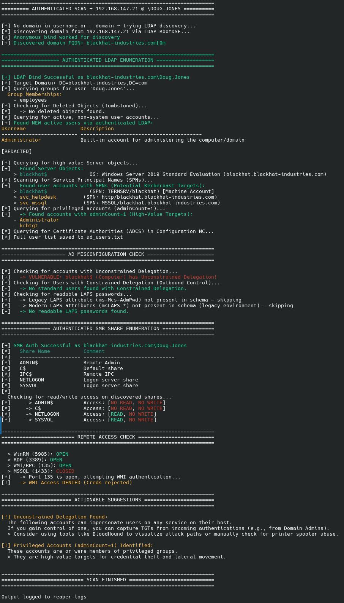

# AD-Reaper

A comprehensive multi-protocol Active Directory (LDAP, SMB, SAMR) enumeration tool.

`AD-Reaper` helps with from getting an **initial foothold** (finding null sessions) to **authenticated auditing** (finding privilege escalation paths). It combines anonymous enumeration techniques with deeper authenticated scanning and post-scan analysis.

Designed to capture and report low hanging fruit fast, with very few dependencies.

**Windows Server 2025+**

Microsoft made LDAP signing the default for new Active Directory deployments on Windows Server 2025.  Any brand-new lab or production domain built on Server 2025 will hit the `LDAP_STRONG_AUTH_REQUIRED / strongerAuthRequired` error on plain NTLM binds over port 389.

LDAPS / StartTLS / signed-NTLM fallback path was added to support the new policy, therefore making it especially useful against fresh 2025 environments and any hardened older ones.

## Modes & Features

- **Null Session Hunting:** Automatically tries both `''` and `.` usernames to bypass weak null session filters on SMB and SAMR.
- **Share Auditing:** Checks permissions across all discovered shares and attempts to identify writable directories.
- **Recursive SMB Walking:** Walks directories to find sensitive files (e.g., `web.config`, `passwords.txt`) if the `--spider-shares` flag is used.
- **Hybrid User Enumeration:** Generates a master user list by combining anonymous LDAP queries (active users) with RPC/SAMR enumeration (all users/RIDs).
- **Group Policy & Object Auditing:** Identifies interesting group memberships, misconfiguration and deleted objects (tombstone). (Auth mode)
- **Server Object Discovery:** Identifies high-value infrastructure (Domain Controllers, File Servers) via anonymous LDAP queries.
- **Other AD Checks:** Looks other common misconfigurations that may be exploitable (ACDS, LAPS, admincount, delegations, etc.).
- **Post-Scan Analysis:** Provides actionable suggestions based on the findings (e.g., reminding you to check for GPP passwords or suggesting specific `secretsdump` targets).
- **AS-REP Roasting:** Tests the discovered user list for accounts that do not require Kerberos pre-authentication.. (Anon mode)
- **Kerberoasting:** Identifies service accounts (SPNs).. (Auth mode) 

## Installation

Supports python versions (3.12+)

- Clone the repository:

```bash
git clone https://github.com/mermehr/ad-reaper.git
cd ad-reaper
```

- Install dependencies:

```bash
pip install -r requirements.txt
```

## Usage

```bash
usage: ad-reaper.py [-h] [-u USERNAME] [-p PASSWORD] [-H HASHES] [-d DOMAIN] [-o OUTPUT]
                    [--spider-shares]
                    target

Multi-protocol Active Directory Enumeration Tool

positional arguments:
  target                DC IP

options:
  -h, --help            show this help message and exit

Authentication:
  -u, --username USERNAME
  -p, --password PASSWORD
  -H, --hashes HASHES   LM:NT hash
  -d, --domain DOMAIN   Force domain name (useful when discovery fails)

Output & Modules:
  -o, --output OUTPUT   Output dir for logs and hashes (default: reaper-logs)
  --spider-shares       Recursively list files on accessible SMB shares

Examples:
  Anonymous scan:
    python ad-reaper.py 10.10.10.10

  Authenticated scan:
    python ad-reaper.py 10.10.10.10 -u tommy -p Spring2026
    python ad-reaper.py 10.10.10.10 -d example.local -u tommy -p Spring2026

  PTH + output dir:
    python ad-reaper.py 10.10.10.10 -u Administrator -H aad3b...:31d6... --output loot
```

## Screenshots

Authenticated scan log:


